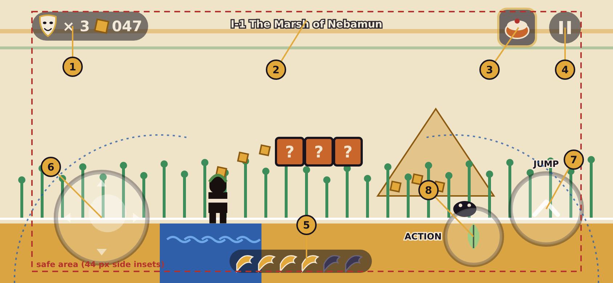
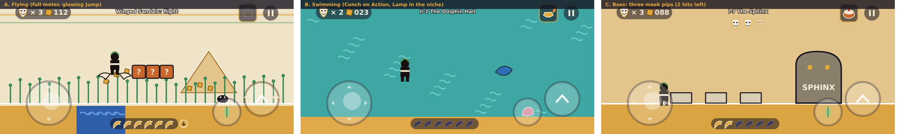

# In-level HUD and touch controls

Companion to [`DESIGN.md`](DESIGN.md) (see section 6, "Suits and items", and section 15, "Platforms and business") and [`LEVEL_MAPS.md`](LEVEL_MAPS.md). Planning only: these are mock-ups at phone size, not final art or a final layout. The mock-ups are SVG with PNG copies in `mockups/`.

**Reference screen:** a phone in landscape at **844 by 390 points** (an iPhone 14-sized screen; the mock-ups are drawn at this size and exported at 2x). The same layout scales to wider phones (about 2.2:1) and, with the on-screen controls hidden, to 16:9 on PC. **Units** below are points; 1 point is one pixel on a 1x screen.

## 1. The layout

Gameplay is a placeholder (Act I's marsh). The red dashed box is the **safe area** (44 points in from the left and right edges for notches and rounded corners, 16 at the top and bottom). The blue dotted arcs are the approximate **thumb reach** from each lower corner.

| # | Element | What it shows | Notes |
|---|---|---|---|
| 1 | **Masks and tesserae** | Comedy masks left (lives) and the tessera count (100 = a life) | A pill in the top-left; a tragedy mask appears only on the Game Over card |
| 2 | **Scene tag** | "I-1 The Marsh of Nebamun" | Fades in on entry and **out after about 3 seconds**; hold the Pause button to see it again |
| 3 | **The Niche** | The **reserve item** (one slot) | Tap to drop it from the top of the screen. Shown as a dashed empty niche when empty. **Not** the Capsa: the 28-slot Capsa is the map screen's inventory, and you pick one item from it before a scene |
| 4 | **Pause** | Two bars | Opens the pause card (section 4) |
| 5 | **Winged meter** | Six little wings that light up as you run | Bottom centre, so neither thumb covers it. A glowing sandal appears when it is **full** (SMB3's P-meter) |
| 6 | **Stick** | A floating stick on the left half of the screen | Appears where the thumb lands. **Pushing it fully means run**, so no third button is needed. Down = crouch, enter a pithos, hold the statue pose |
| 7 | **Jump** | The big button, bottom right | The one you use most, placed under the natural resting thumb |
| 8 | **Action** | A smaller button to the left of Jump, lower | Its icon **changes with the suit** (below) |

## 2. Sizes and touch rules

| Thing | Size | Why |
|---|---|---|
| **Jump** | 96 across | the most-used button, easy to hit without looking |
| **Action** | 76 across | big enough to hit, small enough not to cross Jump |
| **Stick** | 124 across, thumb 52 | floating: appears under the thumb within the left half, so it never needs finding |
| **Niche and Pause** | 52 and 44 | smaller because they are for deliberate taps; spaced at least 10 apart so they are not hit by accident |
| **Minimum hit area** | 48 by 48 for anything tappable | the usual phone guideline; the hit area may be larger than the drawn icon |

- **See-through.** Controls are drawn at about 20 to 25 percent white fill with a **dark outline ring**, so they stay visible on both the pale marsh and the dark tomb. (In the first mock-up pass they vanished against the bright scene; the outline fixes that.)
- **Play space.** The top band is no more than 56 points tall; the bottom meter strip is 32. Nothing else sits over the centre, so hazards and platforms stay visible. Controls sit in the lower corners where the level layout leaves floor, not hazards.
- **Floating stick and fixed buttons.** The stick floats; Jump and Action are fixed so their positions can be learned. Both can be moved and resized (section 5).
- **Labels.** "Jump" and "Action" are written next to the buttons in the **first scene only**, then fade.

## 3. States

| State | What changes |
|---|---|
| **A. Flying** (Winged Sandals, full meter) | The Jump button **glows gold** and grows wings; tap to flap. The Niche is empty (dashed) |
| **B. Swimming** (Conch) | The Action icon becomes the **Conch** (blow it to call a dolphin); the meter is empty (you can't run in water); the Niche holds the Lamp |
| **C. Boss** | **Three small mask pips** appear under the scene tag, one per hit the boss needs; hits dim a pip. Phone players benefit from this, and SMB3 shows none, so it is a gentle addition (see decisions) |

**Action by suit:**

| Suit | Action does |
|---|---|
| none | nothing (the icon is dim) |
| Laurel Wreath | **wreath spin** (stuns enemies, bonks blocks); in the air, hold Jump to glide |
| Triton's Conch | blow the Conch (calls a dolphin); swimming is by tapping Jump |
| Giant Sandal | no Action; hop is Jump |
| Marble Statue | hold Down plus Action for the **statue pose** |
| Winged Sandals | no Action; flight is Jump (tap to flap) |
| Sculptor's Mallet | **throw chips**; crouched, you become a block |
| Orpheus's Lyre | play the tune (sleeps enemies) |

## 4. Pause card

Resume · Restart from the last brazier · Quit to the map · Controls (move, resize, left-hand mode, opacity) · Sound. The **scene tag** reappears here. There is **no timer** (decided), so pausing never costs anything.

## 5. Accessibility and options

- **Left-handed mode** mirrors the layout (stick on the right, Jump and Action on the left).
- **Control size** (small, medium, large) and **opacity** sliders, and a **drag to reposition** mode with the safe area outlined.
- **Not colour alone:** the meter's lit and unlit wings differ in **fill and outline**, and the full meter adds a glowing sandal; counters are numbers; the Jump glow is paired with the drawn wings.
- **Haptics:** a light tick on each coin, a stronger tap on a hit and when the meter fills.
- **Gamepad and keyboard** (PC): the on-screen controls are hidden, the HUD stays, and button prompts show the controller's glyphs.
- **Audio cues** for the meter filling and for a pip being lost.

## 6. Decisions (confirmed)

All four were accepted:
1. **Boss mask pips**: three small pips under the scene tag.
2. **Reserve slot** named the **Niche** (distinct from the Capsa).
3. **Tessera count shown as a three-digit number** next to a small gold tile, with no score counter at all.
4. **Run by full stick push** rather than a run button.

The Capsa and the Muse Shrine screens are in [`SHRINES.md`](SHRINES.md).
