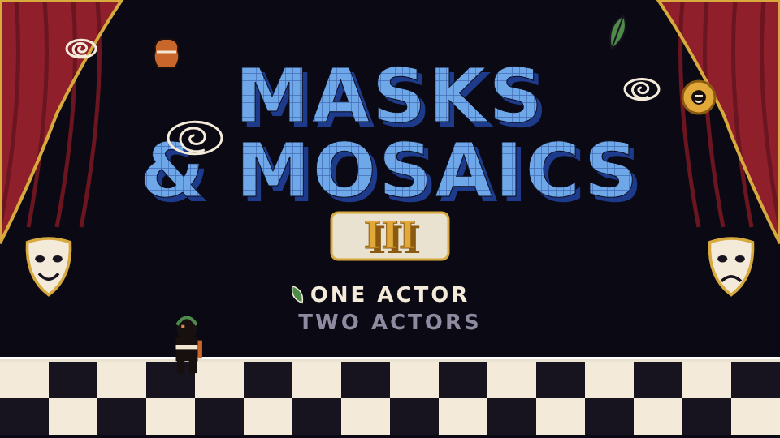
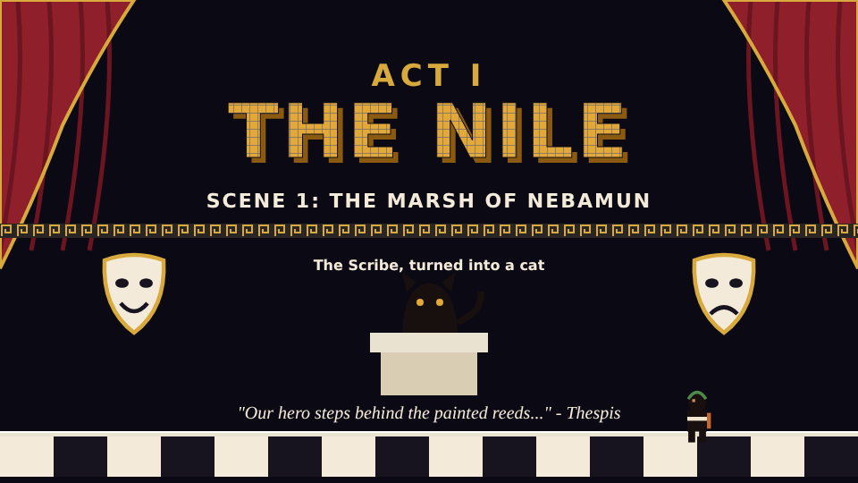
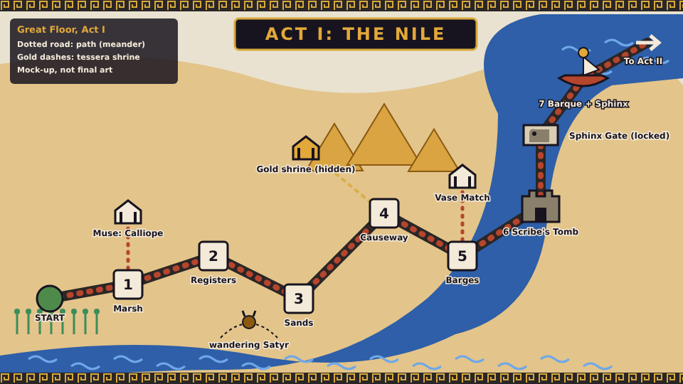

# Maps and screens for *Masks & Mosaics*

Companion to [`DESIGN.md`](DESIGN.md). Planning sketches only: nothing here is game art or a final layout. The pictures are mock-ups (`mockups/*.svg`, with PNG copies) that show the intended composition, and the level layouts are ASCII sketches in the style of the one in `DESIGN.md` section 9. This file covers the screens, the Great Floor, and **all seven scenes of Act I**. The other Acts follow once Act I is signed off.

---

## 1. Title screen



The composition follows SMB3's title screen (black stage, checkerboard floor, hero standing, drifting icons, light-blue logo with a dark offset shadow, a big number) and swaps every element for our theme. Full spec: `DESIGN.md`, section 11 ("The title screen and loading screens").

What the mock-up shows:
- **Curtain** (crimson, gold edge) drawn back at both sides, with **comedy and tragedy masks** at the bottom corners.
- **Logo** in light lapis tesserae with a deep lapis offset shadow (one tile). The real one is built by the mosaic filter, so the tiles follow the letter strokes.
- **Roman numeral III** in gold on a marble plaque, where SMB3 has its orange "3".
- **Drifting icons:** Ambrosia Cake (an amphora stands in here), laurel leaf, the Aegis, and Minoan spirals for the clouds.
- **Menu:** "One Actor" and "Two Actors" with a laurel-leaf cursor.
- **Floor:** a black-and-white mosaic checkerboard with a pale stage lip; the hero is a placeholder black-figure silhouette (a random one of the four artists each time, decided).

## 2. Act intro and loading card



Shown when you enter an Act or a scene, and while a scene loads:
- **"ACT I / THE NILE"** in gold tesserae, and the scene line ("Scene 1: The Marsh of Nebamun").
- A **meander band** as the divider.
- The Act's **Keeper**, transformed (the Scribe, turned into a cat), standing on a plinth, and a line from **Thespis**.
- The same stage and floor as the title screen, so every loading screen reuses one set of assets.
- Short loads show only the hero's mask. The **game-over** card is the same stage with a tragedy mask that turns back into a comedy mask.

## 3. The Great Floor: Act I map



The map is a top-down Roman floor mosaic, so the pictured river, desert and pyramids will be drawn as tesserae. It follows SMB3's World 1 map (a winding path of numbered levels, a fortress that unlocks a gate, shrines off to the side, a ship at the end), with our map features:

| On the map | What it is |
|---|---|
| **Start** (green) | where the Act begins, beside the papyrus marsh |
| **1 to 5** | scenes: Marsh of Nebamun, Harvest Registers, Sands of Giza, Collapsing Causeway, Shaduf Barges |
| **Muse: Calliope** | a Muse Shrine off scene 1 (gives the Laurel Wreath, per the Muse table) |
| **Vase Match** | a Muse Shrine off scene 5 (Thalia's card game) |
| **Wandering Satyr** | walks along the paths; touching it starts a one-screen fight (Lyre makes it sleep) |
| **Gold shrine (hidden)** | appears when you collect every tessera in scene 4 (dashed gold trail) |
| **6 Scribe's Tomb** | the fortress; beating Khepri destroys the door and opens the gate |
| **Sphinx Gate** | locked until the fortress is cleared |
| **7 Barque + Sphinx** | the ship battle and boss, on the Nile |
| **To Act II** | the exit onto the sea |

The **Star Chart** (a warp) is hidden in scene 2, and a second copy in the fortress (which ends it early but leaves the gate shut).

## 4. The whole Great Floor

The eight Acts are islands (panels) on one big floor. Each Act's panel has its own medium and its own shape (decided earlier: the Act III island is a tortoise; Act II has a bull's-horn coast; Act I follows the Nile). The Vandal's cracks spread from the middle outward as the game goes on.

```
                   [V Olympus: clouds above the floor]
                         /               \
 [III Heroes' Vases      ]                 [VII Byzantium: gold]
  (tortoise island)   \                     /
                        \      [VIII]      /
 [II Crete: sea]--------- the Hoard ------- [IV Rome: Pompeii]
   (bull-horn coast)        (cracked          |
                             centre)          |
 [I Nile: start] ---------------------  [VI Etruscan tombs]
   (river, pyramids)                       (underground)
```
Notes:
- **Start** is the Nile at the bottom left; the path winds up through Crete and Heroes' Vases to the sky, then down to Rome, Etruria and Byzantium, and finally into the centre.
- **Cracks** begin in the centre (the Hoard) and spread; each recovered emblema mends the part of the floor nearest its Act.
- The **Star Chart** warp (Urania) jumps between these panels via the **Star Room** (one constellation per Act).
- Act V's panel is drawn **above** the floor, on clouds, with the ground map showing through below it.

## 5. Act I scenes

**Legend** (all sketches): `P` start · `=` ground · `#` stone or mudbrick · `~` water · `|` papyrus reed (bends and springs) · `o` tessera · `?` amphora block · `X` pithos (warp) · `H` ladder · `+` brazier checkpoint · `F` Victor's Dais (goal) · `B` Tessera Beetle · `M` Mudbrick Mimic · `S` Chelone (kickable shell) · `C` the cat · `Q` quicksand · `A` Aten · `J` chained jackal · `L` moving lift or barge · `^` spikes · `K` Kiln Switch. Each sketch shows the main beats; they are not to scale.

### I-1 *The Marsh of Nebamun*  (difficulty about 2/10)

Teaches run, jump, stomp, the shell as a tool, and bending reeds. First suit (Laurel) from an amphora block that only a kicked shell opens.

```
                         ()                ()
              ?  ?  ?              ?
 P        |  |   o o  o        |  |     o  o      +          F
=====~~~====   =========  ~~~~~~~~  ===========  ~~~~======  ====
   S     B           C                  B     X
```
Beats: run, stomp a beetle; kick the shell (`S`) into the ground-level `?` for the Laurel; reeds spring you to a high bird-sky route (tesserae spell a numeral); a pit with a hidden pithos `X`; the cat `C` drops her bird (a coin shower) when stomped; a brazier `+` halfway.

### I-2 *Harvest Registers*  (3/10)

Three stacked **registers** (lanes) like a tomb wall. Hop between them by ladders and gaps. Hidden: an aulos block to a tessera cloud, a **painted-door panel** (crouch on it) to Urania's Star Chart.

```
 R3  =====  o o o   ===========  ?   ===========   [door] =====  F
        H                 H          M               H
 R2  ====  =====  B  ===  Canopic ======  =====  ====   H
      H            H                  H       o  o
 R1  P===  Q==  ======= B ======  ====  o  ====  ====  H  =====  +
```
Beats: ladders up to the top lane for coins, `M` Mudbrick Mimics in the middle lane, a stacked **Canopic** enemy, a crouch-panel at the start of the middle lane that drops you behind the scenery to the Star Chart.

### I-3 *The Sands of Giza*  (3 to 4/10)

Dunes, pyramids and the **Aten** dive. Quicksand pits, a sand-slide, and a high road for a Laurel glide.

```
                 A                          A                      
        ____          o o o        /\                      o o o
   __/\/    \__   /\ /       \  /\/  \ ___         ___   /\  
 P=            ===   Q Q Q    ===      Q Q    ====       ====   F
   B      J             ?       S             M
```
Beats: a long plain with a jackal on a chain `J`; the Aten swoops twice (jump or duck behind a pyramid); a quicksand pit with a snapper; a kicked shell opens a sealed mudbrick wall in the third pyramid; the high road needs a Laurel run-up glide.

### I-4 *The Collapsing Causeway*  (4/10)  *(autoscroll)*

The screen scrolls right at a steady pace. Slabs crumble if you linger; mudbrick walls can push you off. Collect every tessera to make the gold shrine appear on the map.

```
 >>> screen edge >>>
 P  [#]  [#]    [#]  [#]  [#]       [#] [#]  S [###]   [#]  [#]  F
=== crumble == gap == crumble ==== gap ===     ====  gap  = X
         o     o  o      o  o    ?       o o o     B
```
Beats: hop crumbling slabs; a kicked shell breaks a brick wall in your path; a pithos at the end that is also a shortcut; the screen edge crushes if you stop.

### I-5 *The Shaduf Barges*  (4/10)

Introduces moving platforms gradually, as SMB3's 1-6 does: static islands, one see-saw, then ropes and barges. One barge frays at the end.

```
   B          S                   ??
 P====  ===/\===  [L]~~~~[L]    [L]     o o o   [L]~~[L]  ====F
        shaduf see-saw   rope barge  river   fraying barge
```
Beats: static islands with beetles; a **shaduf** see-saw platform (weight on one end lifts the other); rope-and-pulley barges on the river; a visibly frayed barge (loose fibres) that drops at the end of its rope; fish leap.

### I-6 *The Scribe's Tomb*  (fortress, 5/10)

One new hazard per room: fire-cobras, spinning sun-discs, a spiked descending ceiling, then a door to Khepri. Hidden: a second Star Chart (ends the tomb early, leaves the gate shut).

```
 Room 1: fire-cobras           Room 2: sun-discs            Room 3: spiked ceiling
 P ====  U  ===  U  ===        ====  @   ====  @  ====      vvvv  vvvv   vvvv
     o    cobras hop            o         spinning            ==== ==== ====  [door]
                                                     crouch under the descending spikes
```
Beats: three rooms separated by doors that rise and fall; column drums fall in room 3; a Bandage Scamp that reassembles (cap it); the first Shade after the second drum.

**Khepri arena** (mini-boss):

```
 |                                       |
 |   P    =====                          |
 |  =============================  (O)   |   (O) = rolling sun-disc
 |                                       |
```
He rolls the sun-disc toward you: hop it, then stomp him (three stomps). After the first hit he starts **flying** briefly (mini-bosses gain a second move). Defeating him destroys the tomb door and opens the **Sphinx Gate** on the map.

### I-7 *Barque of Millions of Years*  (ship battle, then the Sphinx; 5/10)

An autoscroll along the solar barque, with pot-lobbing catapults and Oarsmen at the oar ports. One power-up at the midpoint (an Ambrosia Cake, or a Lamp if you are already grown).

```
 >>> screen edge >>>
 P  ==  catapult  ==  oarsman  ==  ?(mid)  ==  catapult  ==   [post+crates]  == X
      ( )pots (  ) o   [ ]oar port           ( )pots
 ~~~~~~~~ Nile ~~~~~~~~~~~~~~~~~~~~~~~~~~~~~~~~~~~~~~~~~~~~~~~
```

**The Sphinx arena** (boss):

```
 |                                                  |
 |  The Sphinx (on her plinth)                      |
 |   [animal]     [PERSON]      [bird]   <- riddle plinths
 |  =======      =========      =======            |
 |   P ============================================ |
```
Three plinths show an animal, a person and a bird. Stand on the person plinth and **strike the sun-gong** to hit her; a wrong plinth drops a small hail of sand. Four rounds, each faster.

---

## 6. Acts II to VIII

The maps and scene sketches for the other seven Acts are in [`LEVEL_MAPS_ACTS_II-VIII.md`](LEVEL_MAPS_ACTS_II-VIII.md).

## 7. Still to draw

- (Done: the in-level HUD is in [`HUD.md`](HUD.md).)
- (Done: the Muse Shrine and Capsa screens are in [`SHRINES.md`](SHRINES.md).) The Vase Match screen is in `SHRINES.md` section 4 as well.
- (Done: the Star Room warp map is in [`SHRINES.md`](SHRINES.md) section 5.)
