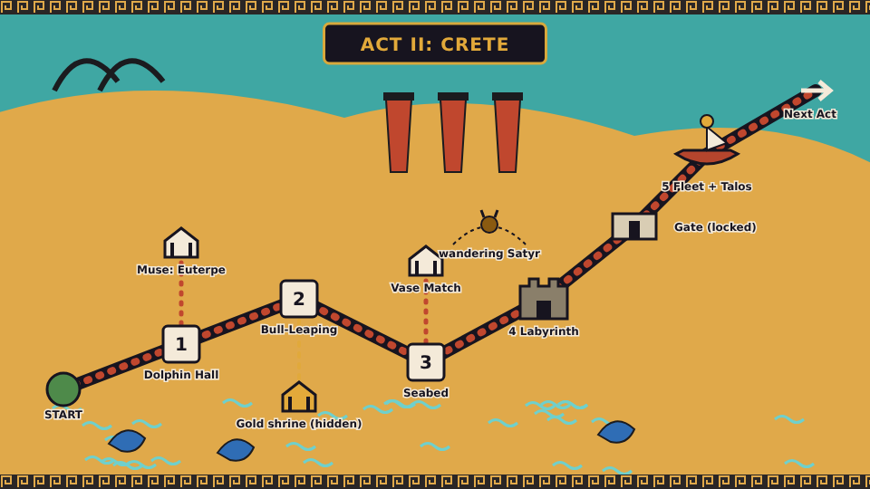
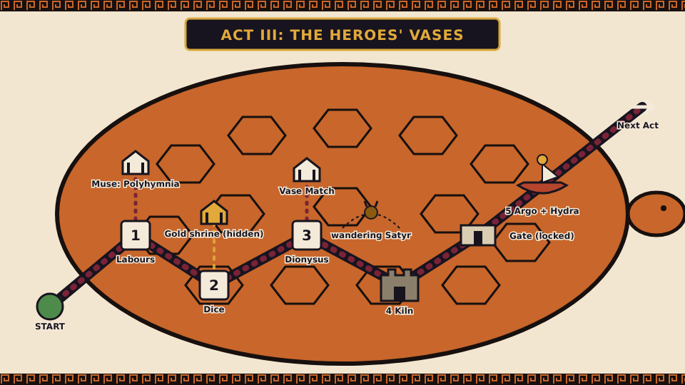
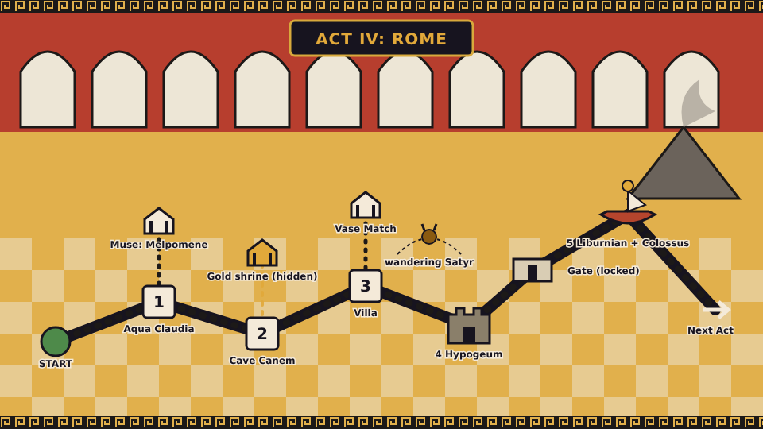
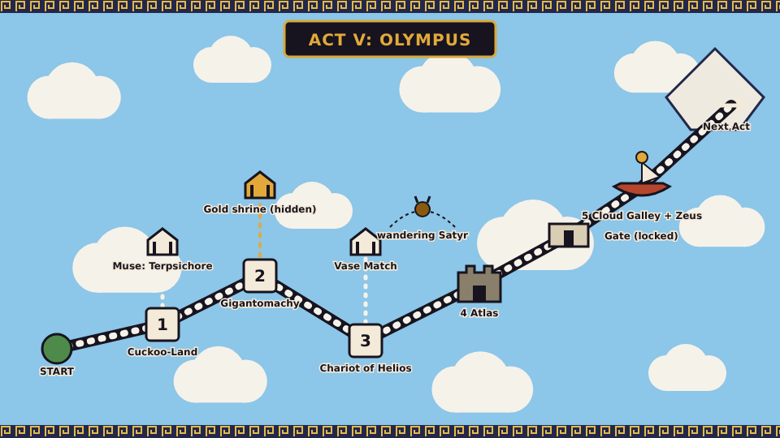
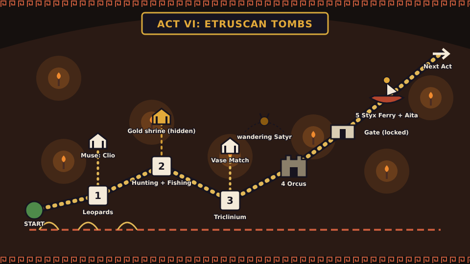
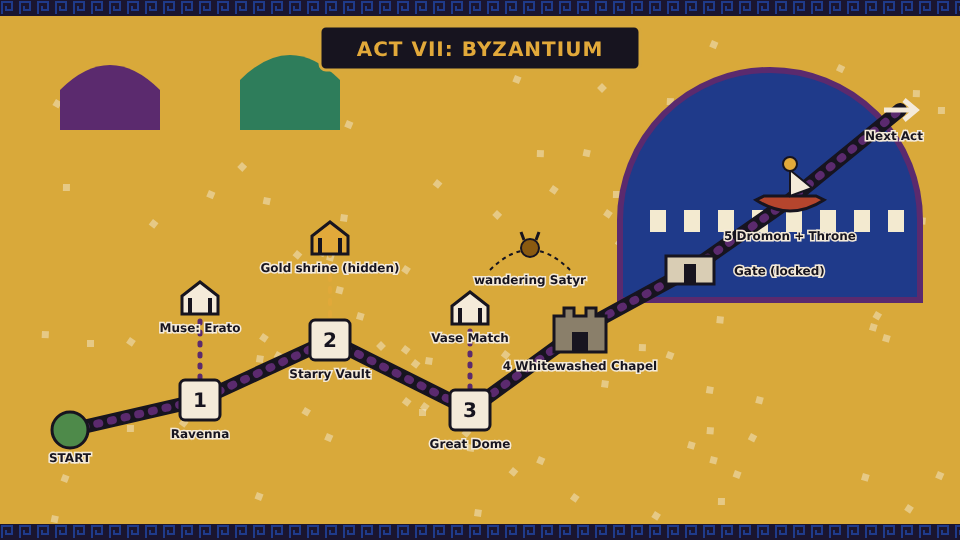
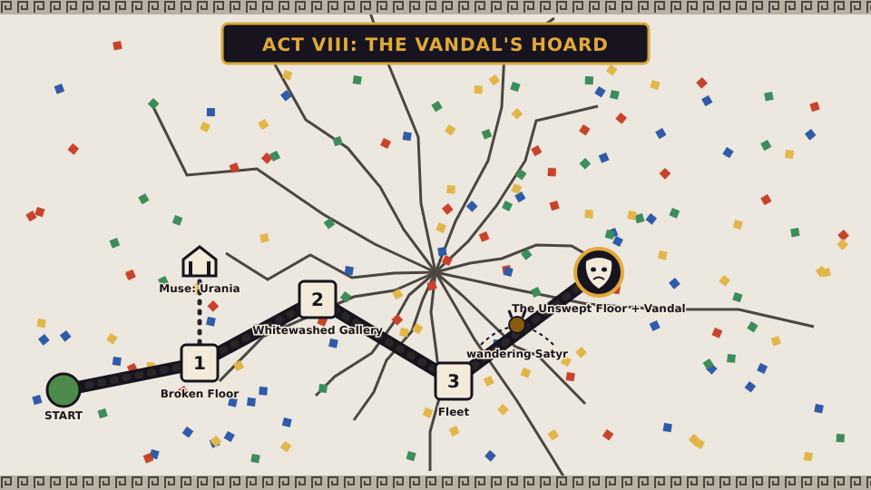

# Maps and scene sketches: Acts II to VIII

Companion to [`LEVEL_MAPS.md`](LEVEL_MAPS.md) (which has the title screen, the loading card and **Act I**) and [`DESIGN.md`](DESIGN.md). Planning sketches only: nothing here is game art or a final layout.

Each Act has:
- a **Great Floor panel** mock-up (SVG with a PNG copy in `mockups/`), in the same format as the Act I map: a winding path of numbered scenes, the fortress, a locked gate, the ship-and-boss node, a Muse Shrine, Vase Match, a wandering Satyr, and the hidden gold shrine;
- **ASCII sketches** of its five scenes (Act VIII has four) and the mini-boss and boss arenas.

**Legend** (shared with Act I): `P` start · `=` ground · `#` stone or brick · `~` water · `o` tessera · `?` amphora block · `X` pithos (warp) · `H` ladder · `+` brazier checkpoint · `F` Victor's Dais (goal) · `B` Tessera Beetle · `S` Chelone shell · `L` moving lift or platform · `^` spikes · `K` Kiln Switch. Extra symbols are explained at the top of each Act. The difficulty marks (out of 10) follow the cap in `DESIGN.md` of about 7 for the main route.

**Which Muse is where** (each Act has one shrine; the items follow the Muse table in `DESIGN.md` section 8): II Euterpe (Lyre), III Polyhymnia (Giant Sandal), IV Melpomene (Marble Statue), V Terpsichore (Winged Sandals), VI Clio (hints), VII Erato (a Comedy Mask), VIII Urania (the Star Chart). Calliope (Laurel) is in Act I and Thalia runs the Vase Match shrines.

---

## Act II: Crete



The island is Crete (the Minoan palace columns are red and taper downward, as in the real ones). The bull-horn coast is top left. Scenes are mostly water. The **Muse** is Euterpe (the Lyre); the **gold shrine** appears when you collect every tessera in scene 2.

`D` dolphin (ride) · `O` octopus · `f` flying fish · `u` urchin · `T` tide line · `J` jelly · `R` raft

### II-1 *The Dolphin Hall*  (4/10)  *(swimming; Conch introduced)*
```
 ~~~~~~~~~~~~~~~~~~~~~~~~~~~~~~~~~~~~~~~~~~~~~~~~~~~~~~~~~~~~~~~~
 P  ~~  f  ~~~  O+oo  ~~~~~~~  u  ~~  f  ~~~~~  ~~~~  ~~~~~~  F
 ~~~~~ D>>>>>>> ~~~~~~~~~~~~~~~~~~~~~~~~~~~~~~~~~~~~~~~~~~~~~~~
 ===== lower route: sea floor, bounce shells, o o o, ? =========
```
Beats: swim by tapping; a fork where the upper route has a mother octopus and her babies (risky, more tesserae) and the lower is bouncy and safe; a Conch is in the first `?`; call a dolphin with the Conch to carry you over urchins.

### II-2 *The Bull-Leaping Court*  (5/10)
```
        ___                                  ___
 P =====   \======= bull >>>>> ==== bull <<<<< ====  ?  ===== F
            vault    horns=spring      horns=spring
 gold shrine route: high flip over the second bull -> o o o o
```
Beats: a charging bull is a moving springboard: grab the horns and flip over; time two bulls in opposite directions; a high flip collects every tessera (the gold shrine).

### II-3 *The Marine Style Seabed*  (5/10)
```
 ~~~~~~~~~~~~~~~~~~~~~~~~~~~~~~~~~~~~~~~~~~~~~~~~~~~~~~~~~~~~~~
 P  @tentacle   ~   u  J  ~~~   @tentacle  ~  O   ~~~  ~~~   F
 ~~~~ seaweed spirals ~~~~~ ~~~~~~  octopus-pot  ~~~~~~~~~~~~~~
 =======  rock  ======= rock ========= rock ====== rock ======
```
Beats: spiralling octopus tentacles sweep like clock hands; urchins on rocks, a stinging jelly `J` that is a pure hazard; a Giant Fish lunges in the last third.

### II-4 *The Labyrinth*  (fortress, 5/10)
```
 [start]--door--[R1]--door--[R2]--door--[R3]--door--[boss]
   P    thread->  loops back      thread->     wrong door = loop
```
Beats: a maze of doors; **Ariadne's thread** (a glowing line on the floor) shows the right door; wrong doors loop you back; a flooded variant is in the scene bank.

**Minotaur arena** (mini-boss, called Asterion):
```
 |                                       |
 |  P                                    |
 |  ===============================  [wall] <- he rams it, then is stunned
 |             Asterion  >>>>>           |
```
He charges and rams a wall; strike him while he is stunned. After the first hit he **charges through a gap** (mini-bosses get a second move).

### II-5 *The Fleet of Thera*  (ship, then Talos; 5/10)
```
 >>> screen edge >>>
 P == oar port == ( )pots == ? == oar platform (rising and sinking) == X
 ~~~~~~~~~~~~~~~~~~~~~~~~~ sea ~~~~~~~~~~~~~~~~~~~~~~~~~~~~~~~~~~
```
**Talos arena** (boss):
```
 |                                            |
 |     Talos (bronze, circling the island)    |
 |       o ankle plug                          |
 |  P ======== deck ==========                 |
```
He circles and hurls rocks that **ricochet** (as Wendy's rings do); the weak spot is the ankle plug (three hits); he **leaps higher** after each hit.

---

## Act III: The Heroes' Vases



The Great Floor panel is a **tortoise** (*chelone*: Hermes made the lyre from a tortoise shell), with a black meander border. The **Muse** is Polyhymnia (Giant Sandal).

`G` giant (enemy) · `V` painted vase handle · `K` Kiln Switch · `D` Kiln door (scale) · `E` ember · `E>` creeping ember

### III-1 *The Labours Frieze*  (4/10)  *(giant scale; Giant Sandal)*
```
 P ==== [GIANT BEETLE] ==== ? ==== [GIANT CHELONE] ==== X ====== F
        (3 stomps)             kick giant shell into mega ?
```
Beats: you are tiny; giant enemies take three hits; kick a giant shell into a mega `?` for the Giant Sandal; a looping frieze of the labours behind you.

### III-2 *Achilles and Ajax Play Dice*  (5/10)
```
 P === [dice 3] === [dice 4] ===  spear  === [dice] === ?? ===  F
         "TRIA"        "TESSARA"
```
Beats: dice are platforms that tip; the heroes' inscriptions pop out as sound effects; a hidden room shows the word *tessara* (the origin of "tessera").

### III-3 *Dionysus Sails*  (5/10)  *(vase wrap-around; Kiln Switch)*
```
 (the level is a ring: left edge joins right edge)
 P ~~~ dolphin ~~~ [mast + vine] ~~~ dolphin ~~~ K ~~~ eye ~~~ -> P
```
Beats: round the cup; the Kiln Switch flips black-figure to red-figure, swapping what is solid; giant painted eyes on the cup blink and follow you.

### III-4 *The Kiln*  (fortress, 6/10)
```
 P === [slide: drum] ===  E> E> E>  === [crumbling plinth] === [boss]
          sliding column            creeping embers (move when you look away)
```
**Nemean Lion arena** (mini-boss):
```
 |  P                           |
 |  ==========================  |  his pelt can't be pierced:
 |        Lion (rolls, yawns)   |  hit him when he rolls over and yawns
```
He is only hurt when he yawns; after the first hit he **leaps across the room**.

### III-5 *The Argo*  (ship, then the Hydra; 6/10)
```
 >>> screen edge >>>
 P == harpy ~~ [oar] == ? == harpy ~~ == X
 ~~~~~~~~~~~~~~~ Argo on sea ~~~~~~~~~~~~~~~~~~~~
```
**Hydra arena** (boss, on a tilted raft):
```
 |    (head)  (head)  (head)       |
 |       \      |      /           |
 |   P ====== raft (tilted) ====== |
```
Strike a head and two grow back unless you **cauterise the stump with the Oil Lamp**; the Hydra retreats under the water between attacks; the raft tilts as you move.

---

## Act IV: Rome



A Pompeian-red wall of arches (the aqueduct) runs across the top, Vesuvius smokes at the right, and the floor is a black-and-white mosaic. The **Muse** is Melpomene (Marble Statue).

`W` water jet or flow · `V` valve (tap) · `A` Acanthus Snapper · `Dh` Cave Canem hound · `T` thistle · `Z` Pot Bomb · `L` lift

### IV-1 *The Aqua Claudia*  (5/10)  *(water flow; lead pipes)*
```
 ===arch===arch===arch===arch===arch===arch===arch===arch===
 P ~~~>>>>> channel ~~~>>>>>  W up  ~~~>>>>>  A  ~~~  X  F
```
Beats: ride the water channel along the top of the arches; lead pipes are the warps; Acanthus Snappers pop out of pipes.

### IV-2 *Cave Canem*  (5/10)
```
 P === Dh<-chain ==== atrium ==== Dh ====  floor mosaic (Alexander) ==== F
        lunges when you linger                     ?  o o o
```
Beats: a Pompeian street and house; hounds on chains that slip free if you linger; cross the Alexander mosaic floor.

### IV-3 *The Villa of the Mysteries*  (6/10)
```
 red wall: figure steps out > platform:  [fig] [fig] [fig]
 P === V (turn tap) ===  W  ===  [fig]  ===  V  ===  [fig]  ===  F
```
Beats: fresco figures step out of the wall and become platforms; valves redirect the water that carries you.

### IV-4 *The Hypogeum*  (fortress, 6/10)
```
 P === lift(up) === trapdoor === net >>>> === lift(down) === [boss]
```
**Retiarius arena** (mini-boss):
```
 |  P                             |
 |  ==== sand floor ===========   |
 |           Retiarius  ~net~     |
```
He throws nets you hop; after the first hit he also **throws his trident**. The **Marble Statue** is introduced here.

### IV-5 *The Liburnian*  (ship, then the Colossus; 6/10)
```
 >>> screen edge >>>
 P == catapult == Z == ?(mid) == catapult == X
 ~~~~~~~~~ Tiber ~~~~~~~~~~~~~~~~~~~~~~
```
**Colossus arena** (boss): you fight on a rising and falling arena floor while Vesuvius rumbles behind.
```
 |       Colossus of Nero (bronze, 30 m)       |
 |  P ======= floor (rises / falls) =======    |
```
He stamps, shaking the floor (stand in the air to avoid paralysis, like Roy's stomp); after a hit he **sits down** to protect his head (like Ludwig).

---

## Act V: Olympus



The Great Floor panel is drawn on **clouds above the floor** (the ground map shows through below). The Olympus peak is at the top right. The **Muse** is Terpsichore (Winged Sandals).

`c` cloud puff (sinks) · `N` Nephele · `Pg` Pegasus platform · `W` wax wings (joke item) · `R` rotating cloud

### V-1 *Cloud-Cuckoo-Land*  (5/10)
```
 P === c === c === [wall]  N ->  === R === c === bird-gate === F
        cloud platforms     tosses things
```
Beats: a walled city of bird-people in the sky (from Aristophanes' *The Birds*); Nephele rides a cloud and tosses things.

### V-2 *The Gigantomachy*  (5/10)
```
 [relief giant] [giant, snake legs]  [relief giant]
 P ====== marble ledge ====== ? ====== ledge ====== F
```
Beats: a marble-relief look with parallax; giants whose legs are snakes.

### V-3 *The Chariot of Helios*  (6/10)  *(autoscroll; Winged Sandals)*
```
 >>> screen edge >>>
 P == c == Pg ~~ == W (wax wings: melt near the sun) == c == F
```
Beats: a scrolling sky ride; **Winged Sandals** flight is introduced; Icarus cameos and offers the Wax Wings (a joke item that melts near the sun).

### V-4 *Atlas*  (fortress tower climb, 6/10)
```
        F
     =======
   ======
      =======   <- sun-fire above and below
   ======
 P =====
```
**Atlas arena** (mini-boss): strike his hands and he lets the sky slip; after the first hit he **shakes the tower**.

### V-5 *The Cloud Galley*  (ship, then Zeus; 7/10)
**Zeus arena** (boss):
```
 |      ZEUS (zig-zag bolts, swan, bull)     |
 |  P ======= cloud floor =========          |
```
Dodge zig-zag bolts; his **stamp** paralyses you unless you are in the air; he turns into a swan and then a bull mid-fight, and laughs when you dodge.

---

## Act VI: The Etruscan Tombs



A dark cavern lit by torches, with tomb-wall paintings in ochre. The **Muse** is Clio (hints). Dark levels keep a faint lit rim on hazards (see `DESIGN.md` section 11).

`@` lamp light radius · `Df` false door · `Sh` Shade · `Ch` Charun · `b` beat platform (appears on the beat)

### VI-1 *The Tomb of the Leopards*  (5/10)  *(lamp light)*
```
 P === [banquet table] === Sh === [musician] === Df === [leopards] === F
   @ your lamp lights the painted wall as you pass
```
Beats: only your lamp lights the wall; paintings appear as you pass; musicians' notes show where the floor is.

### VI-2 *Hunting and Fishing*  (6/10)
```
 P === [sea scene] ~~~~ diver (platform) ~~~~ boat ~~~~ F
```
Beats: a sea section in the tomb; divers are moving platforms.

### VI-3 *The Dancers' Triclinium*  (6/10)  *(beat platforms)*
```
 P  b   b   b   b   b   b   b   b   F
    (each b appears on the beat of the dance)
```

### VI-4 *The Tomb of Orcus*  (fortress, 6/10)
```
 P === Df === Df === Df === [spiked ceiling vvvv] === [boss]
        false door: some are real, some are painted
```
**Charun arena** (mini-boss): a blue Etruscan demon with a big hammer; hop his shockwave and strike him. After the first hit he **throws his hammer**. The **Sculptor's Mallet** is introduced here.

### VI-5 *The Ferry on the Styx*  (ship, then Aita; 6/10)
**Aita arena** (boss): the arena is dark, lit by your lamp.
```
 |   AITA (wolf-skin cap)    PHERSIPNAI |
 |  P ========= dark floor ==========    |   @
```
Dodge his thrown pomegranates; Phersipnai calms him between attacks.

---

## Act VII: Byzantium



A gold-ground mosaic with a lapis dome at the right. The **Muse** is Erato (a Comedy Mask). Gold is for the background only (see readability rules).

`g` gold floor (slippery) · `^b` light beam (updraft) · `W` whitewash · `Wh` Whitewasher · `C` chandelier (swings)

### VII-1 *The Procession at Ravenna*  (6/10)
```
 P gggg figure gggg figure gggg  ?  gggg figure gggg  F
    polished floor: slippery; figures are original, not copies
```

### VII-2 *The Starry Vault*  (6/10)
```
 *   *   *     *   *    *    *
   P ===* ===*  ===*  ===*  ===* ===  F
   (the stars are the platforms; the vault is the sky)
```

### VII-3 *The Great Dome*  (7/10)
```
        F
     =======  ^b
  C        ^b   C
 ^b   ======
   P =====
```
Beats: climb inside the dome; light beams lift you like an updraft; chandeliers swing.

### VII-4 *The Whitewashed Chapel*  (fortress, 7/10)
```
 P WWWWWW  (scrape with the Mallet to reveal the path) WWWWWW  [boss]
```
**Whitewasher arena** (mini-boss): his bucket drops whitewash on the floor; **scrape it off** with the Mallet; after the first hit he **paints a wall solid**.

### VII-5 *The Dromon*  (ship, then the Throne of Solomon; 7/10)
**Throne arena** (boss): golden automaton lions and singing birds come in waves; the throne rises as it fights.
```
 |        THRONE OF SOLOMON (rises)       |
 |  lion <<<<       >>>> lion    birds ~~ |
 |  P ====== floor ============           |
```
The lions throw **bouncing golden balls** (like Lemmy); the birds sing a tune you must match with the Lyre.

---

## Act VIII: The Vandal's Hoard



The map is the **cracked centre** of the Great Floor: whitewashed plaster with cracks radiating outward and loose tesserae in every Act's colours. There is no fortress or gate; the **Muse** is Urania (the Star Chart). The Act ends at the Vandal's lair.

`T` loose tessera (falls) · `Wh` Whitewasher · `Hd` statue hand · `Tr` Trojan Horse · `A` Aten

### VIII-1 *The Broken Floor*  (6/10)
```
 P [T][T]   gap   [T][T][T]   gap   [T]  [T][T]  F
    tiles fall as you step; re-lay them by walking
```

### VIII-2 *The Whitewashed Gallery*  (6/10)
```
 [Act I wall]  Wh  [Act II wall]  Hd  [Act III wall]  Wh  [Act IV wall]  F
 each room recalls one Act's trick, in whitewash
```
Beats: throw tesserae to recolour and open paths; a trap room of statue hands that grab.

### VIII-3 *The Fleet of the Great Vandal*  (7/10)
```
 >>> screen edge >>>
 P == trireme == siege tower == trireme == [Tr: Trojan Horse] == X
 ~~~~ sea ~~~~~~~~~~~~~~~~~~~~~~~~~~~~~~~~~~~~~~~~~~~~~~~~~~~~~
```
Beats: each ship uses a different Act's enemies; the last carries the Hoard in a **Trojan Horse** you cross on top of while it fires; the **Aten** chases you through a sand-slide shortcut.

### VIII-4 *The Unswept Floor*  (final boss, 7/10)
**Great Vandal arena** (shaped like Sosus's *Unswept Floor*, with food scraps and a mouse):
```
 |                                          |
 |     VANDAL (maul + broom)  /\            |
 |  P =================================    |
 |   [floor tiles: smashed in rows]         |
 |   (mouse) ,                              |
```
He breathes his smashes at varying heights (jump or crouch), then **leaps and smashes the floor**, dropping rows of tiles; make him land on the same spot two or three times to open the pit. Three falls and the Hoard opens under him; the arena **changes medium** (flat colour, then vase, then gold mosaic) as he gets more frantic.
