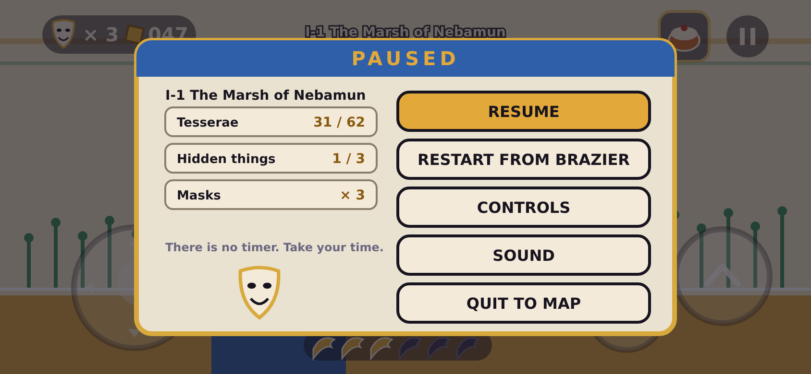
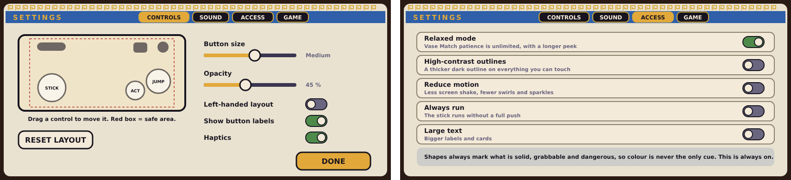
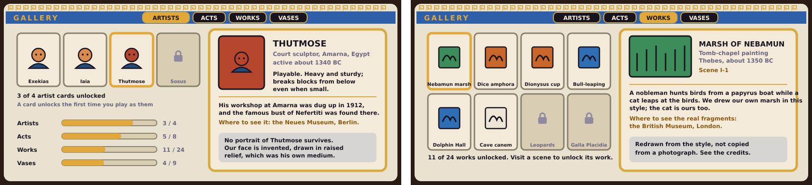

# Pause, settings and gallery screens

Companion to [`HUD.md`](HUD.md) and [`SHRINES.md`](SHRINES.md). Planning only: these are mock-ups (SVG with PNG copies in `mockups/`) at the same 844 by 390 point landscape phone size, not final art. They finish the list of screens that the design doc called out: with these, every screen type in the game has a drawing (title and loading card, map, level HUD, Muse Shrine, Capsa, Vase Match, Star Room, pause, settings, gallery).

All three use the **stage vocabulary** of the other menus: a lapis band with a gold title, a meander border, marble panels, and gold-ringed buttons.

## 1. Pause

Opened with the Pause button in the HUD. The game dims behind a marble card.

| Part | What it is |
|---|---|
| **Header** | "PAUSED", and the scene name below it |
| **Scene stats** | **Tesserae** found out of the scene's total, **Hidden things** found (secret rooms, hidden blocks, the Star Chart), and **Masks** (lives) |
| **A comedy mask** | A friendly mark at the bottom of the left column; it is the one place the tragedy mask never shows |
| **"There is no timer. Take your time."** | A reassurance in a small line; it also tells new players there is no clock |
| **RESUME** | The big gold button, at the top |
| **RESTART FROM BRAZIER** | Goes back to the last checkpoint brazier you lit (or to the start if none) |
| **CONTROLS** | Opens the settings screen on the Controls tab, so layout can be fixed mid-scene |
| **SOUND** | Opens the Sound tab |
| **QUIT TO MAP** | Returns to the Great Floor (asks nothing: progress in a scene is already saved at each brazier) |

Rules: pausing is free; tapping outside the card resumes; the Pause button is 44 points with a 10-point margin so it is not hit by accident (as in `HUD.md`).

## 2. Settings

Four tabs along the top: **Controls**, **Sound**, **Access**, **Game**. **Left: the Controls tab. Right: the Access tab.**

**Controls tab**
- A **miniature phone** shows the layout: the stick, Jump, Action, the counters, the Niche and Pause, and the red-dashed **safe area**. **Drag** any control to move it; resizing and opacity apply live.
- **Button size** (small, medium, large) and **Opacity** sliders.
- **Left-handed layout** mirrors the screen.
- **Show button labels** (the Jump and Action words next to the buttons).
- **Haptics.**
- **RESET LAYOUT** and **DONE.**

**Sound tab** (not drawn): music volume, effects volume, a mute switch, and a "play the lyre" test tap that plays a sample so the sliders are easy to judge.

**Access tab**

| Option | What it does |
|---|---|
| **Relaxed mode** | Vase Match patience is unlimited and its peek is longer (`SHRINES.md` section 4) |
| **High-contrast outlines** | A thicker dark outline on everything you can touch, over the usual one (`DESIGN.md` readability rules) |
| **Reduce motion** | Less screen shake, fewer drifting spirals and sparkles |
| **Always run** | The stick runs without needing a full push |
| **Large text** | Bigger labels, cards and counters |
| (a note) | "Shapes always mark what is solid, grabbable and dangerous, so colour is never the only cue. This is always on." This is a statement, not a switch, because it is how the game is drawn |

**Game tab** (not drawn): **Language**; **Cloud save** status and a button to sync; **Restore purchases** (required by the app stores); the **Privacy policy** link (the repository already has `docs/privacy-policy.md`); **Credits** (the sources screen, below); and **Reset progress**, which sits behind a clear two-step confirmation.

## 3. Gallery

The gallery is the "museum" part of the game: a collection of **cards** that unlock as you play. **Left: the Artists tab. Right: the Works tab.**

Four tabs and their counts:

| Tab | Cards | Unlocks when |
|---|---|---|
| **Artists** | 4 (Exekias, Iaia, Thutmose, Sosus) | you first **play as** that artist |
| **Acts** | 8 | you first **enter** the Act |
| **Works** | 24 (three source works per Act) | you clear the scene that is based on it |
| **Vases** | 9 (the vase shapes) | you first **match** that shape in Vase Match |

**The screen**
- A **grid of cards**, with a gold ring on the selected one and a padlock on locked ones (locked cards show the name so players know what to look for).
- **Progress bars** per tab on the left of the Artists view.
- A **detail card** in the style of a **museum label**, on the right.

**What a card says** (the same fields on every card, so players learn where to look):
1. **Name**, and who or what it is, with a period or place.
2. **Where it appears in the game** (the scene number, or "Playable").
3. **A short note** about the real thing.
4. **"Where to see it"**: the real museum or site, in gold.
5. **A grey note** at the bottom: for artists, "No portrait survives; our face is invented" and the medium we drew them in; for works, "Redrawn from the style, not copied from a photograph".

**Honesty rules:** every statement about a real object (its date, its maker, where it is kept) must be **checked against a reliable source before release** (the mock-up uses the Nefertiti bust in the Neues Museum in Berlin and the Nebamun painting fragments in the British Museum, both of which I believe are correct, but they are placeholders until checked). Restored works (such as the Knossos frescoes) say they are restored.

## 4. Credits and sources (not drawn)

A scrolling credits screen, opened from the Game tab and after the ending: the people and tools, the **list of source works we drew inspiration from** (with the museum and the period), and the line that **all art is redrawn, not traced from museum photographs** (`DESIGN.md` section 14). It also has a thanks line for each Muse's attribute, for fun.

## 5. Decisions to confirm

1. **Pause shows scene stats** (tesserae, hidden things, masks), with five buttons as drawn. Recommended: yes.
2. **Settings has four tabs** (Controls, Sound, Access, Game) with the contents above. Recommended: yes.
3. **Gallery has four tabs** and **24 works** (three per Act), unlocking as listed. Recommended: yes.
4. **A card unlocks the first time you play as an artist**, rather than at the start. Recommended: yes.
5. **Every museum or date on a card is verified before release.** Recommended: yes (non-negotiable).
6. **Reset progress** is a two-step confirmation inside the Game tab. Recommended: yes.
