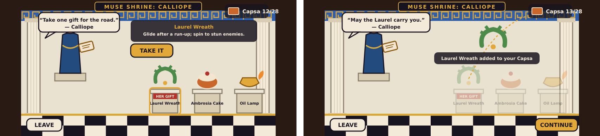
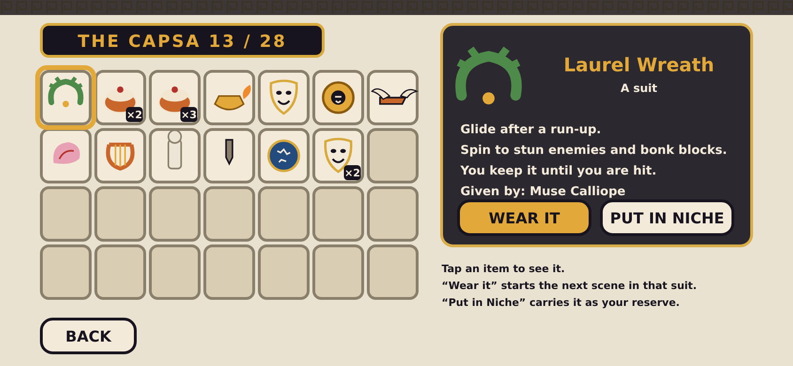
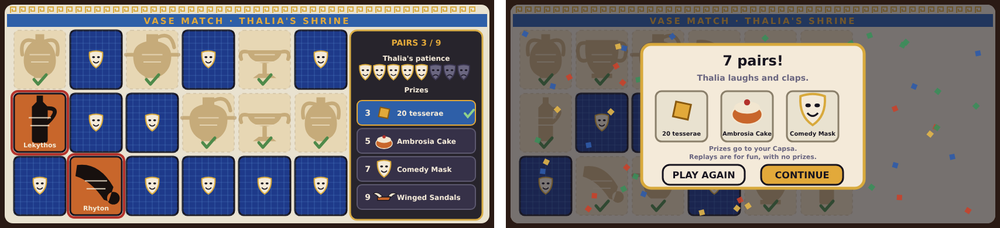
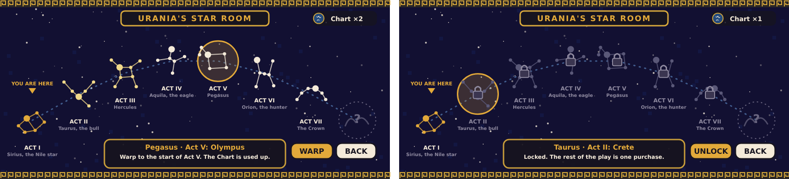

# Muse Shrines and the Capsa

Companion to [`DESIGN.md`](DESIGN.md) (section 8, "The Great Floor", has the nine Muses and what they give) and [`HUD.md`](HUD.md). Planning only: the pictures are mock-ups (SVG with PNG copies in `mockups/`), not game art. The screen size is the same 844 by 390 point landscape phone as the HUD.

A **Muse Shrine** is SMB3's Toad House: a small stop on the Great Floor where a friendly NPC hands you an item. Ours has one change worth noting: **you see what is on offer and choose**, instead of opening unknown chests. A phone player should never have to gamble on a tap.

## 1. The shrine screen

**Left: browsing.** **Right: after taking the gift.**

| Part | What it is |
|---|---|
| **Room** | A small marble shrine: a lapis frieze with a meander band, two columns, and a black-and-white mosaic floor, the same stage vocabulary as the title screen |
| **The Muse** | A figure on a plinth with her attribute (Calliope holds a scroll), drawn in red-figure style, with a **speech bubble** |
| **Three pedestals** | Each holds one item, with its name. The Muse's **signature gift** (the one in the Muse table in `DESIGN.md`) has a red **HER GIFT** ribbon, and the other two are common helpers |
| **Tap an item** | It is **highlighted** and a dark card at the top shows its name and what it does. A **TAKE IT** button then confirms, so a stray tap never costs you the choice |
| **After taking** | The other two items fade, the chosen one **arcs up into the Capsa badge** (13/28) with a line of confirmation, and the Muse says a blessing. **CONTINUE** returns to the map |
| **LEAVE** | Always available, bottom left; leaving without taking anything is allowed, and you can come back |

**Rules**
- **One gift per shrine** (as an SMB3 Toad House is used up): afterwards a small **laurel mark** shows on the map, and a revisit gets a **free tip or a verse of the Act's music** from the Muse, no item.
- **Both helpers are always visible.** There are no hidden contents.
- **Full Capsa:** if the Capsa is at 28 of 28 distinct items, the Muse says so and the screen offers to swap an item for the gift.
- **Thespis** is the shrine usher, so the first shrine of the game has him explain the screen in one line. Once an Act's boss is beaten, the transformed Keeper also appears at the shrine's door.

## 2. What each Muse offers

Each shrine has the Muse's **signature gift** plus two helpers (Ambrosia Cake, Oil Lamp, Aegis, a Comedy Mask or a map Chisel). The signature gifts follow the table in `DESIGN.md` section 8; the helper pairs are my first proposal.

| Act | Muse | Signature gift (HER GIFT) | Helpers on offer |
|---|---|---|---|
| I | Calliope | Laurel Wreath | Ambrosia Cake, Oil Lamp |
| II | Euterpe | Orpheus's Lyre | Ambrosia Cake, Comedy Mask |
| III | Polyhymnia | Giant Sandal | Ambrosia Cake, Oil Lamp |
| IV | Melpomene | Marble Statue | Ambrosia Cake, map Chisel |
| V | Terpsichore | Winged Sandals | Ambrosia Cake, Comedy Mask |
| VI | Clio | **Hint** (shows one secret on this Act's map) | Ambrosia Cake, map Chisel |
| VII | Erato | Comedy Mask (an extra life) | Ambrosia Cake, Oil Lamp |
| VIII | Urania | Star Chart (warp) | Ambrosia Cake, Aegis |
| any | Thalia | a round of **Vase Match** (no item; see below) | (prizes) |

Notes:
- The **Laurel Wreath** is on offer in Act I only, so the suit is introduced early; later Acts can drop Laurels as pickups in scenes.
- The **Mallet and Chisel** suit arrives in Act VI as a scene reward (Charun's fight), not from a Muse.
- A **Muse who only gives a Hint** (Clio) never shows an item she has no use for: her helpers are neutral.

## 3. The Capsa

The Capsa is the **inventory on the map screen**: 28 slots in 7 columns and 4 rows (the same size as SMB3's), opened from the map. It is *not* in the level HUD, which only has the one-slot **Niche** (the reserve item).

| Part | What it is |
|---|---|
| **Grid** | 28 slots, each a distinct item with a stack count (shown as a small ×2 badge). A slot may stack up to 9 of one item. Selected slot has a gold ring |
| **Detail panel** | Name, whether it is a suit or a map item, what it does, and which Muse gave it |
| **WEAR IT** | Starts the next scene in that suit (the suit is spent when you are hit, as usual) |
| **PUT IN NICHE** | Carries the item into the next scene as the in-level reserve, usable by tapping the Niche |
| **USE** | For map items instead of "Wear": the **Chisel** (break a rock), the **Star Chart** (warp), the **Lyre** (sleep a Satyr), Nephele's cloud (skip a scene) |
| **BACK** | Returns to the map |

- Items persist across sessions with **cloud save**, as in the other two games.
- Item icons are the same as the ones on the pedestals and in the Niche, so a player learns them once.
- **Empty slots** are drawn but dimmed, so the 28-slot size is visible at a glance.

## 4. Vase Match

Thalia's shrine runs **Vase Match**, SMB3's card-matching game with vases: 18 face-down vases in a 6 by 3 grid, nine shapes, each twice. **Left: in play** (3 pairs found, a miss showing). **Right: the result card** (7 pairs, three prizes).

**How a round plays**
1. **Peek.** All 18 vases show face-up for 2 seconds (3 in Assist), then flip down.
2. **Turn.** Tap one vase, then another. Both stay up for about a second.
3. **Match:** the pair clears with a gold flash and a tessera clink, and leaves a faint ghost with a green check. **No match:** both flip back, and Thalia says a mild "oh!"; one of **Thalia's patience** masks turns from comedy to tragedy.
4. **End.** The round ends when all 9 pairs are found, or when the 8 patience masks run out. There is **no timer**, and you never lose anything: you keep every prize you reached.
5. **Prizes** (cumulative, shown as a ladder in the side panel): 3 pairs gives 20 tesserae, 5 gives an Ambrosia Cake, 7 adds a Comedy Mask, 9 adds Winged Sandals. The 7-pair result card in the mock-up shows the first three.
6. **After the round:** prizes go to the Capsa. You get **one prized round per Vase Match shrine**; **replays are for fun, with no prizes.** The result card offers PLAY AGAIN and CONTINUE.

**The nine shapes**, each with a gallery card the first time you match it (the gallery text names real Greek vase shapes):

| Shape | What it was for |
|---|---|
| **Amphora** | a two-handled jar for storing and carrying wine or oil |
| **Hydria** | a water jar with three handles: two to lift and one to pour |
| **Kylix** | a shallow drinking cup on a stem, used at drinking parties |
| **Krater** | a big bowl for mixing wine with water |
| **Lekythos** | a tall, narrow oil flask, often left at graves |
| **Oinochoe** | a jug for pouring wine |
| **Pelike** | a squat storage jar, a stubbier cousin of the amphora |
| **Skyphos** | a deep drinking cup with two small horizontal handles |
| **Rhyton** | a drinking horn, often ending in an animal's head |

**Readability and accessibility**
- Each vase is a **black-figure silhouette with incised lines** on an orange card, and the **silhouettes differ clearly in outline**, so matching never depends on colour. The name is written on every face-up card.
- Card backs are one uniform lapis mosaic with a small comedy mask, so no card back gives anything away.
- A card is **88 by 100 points** with an 8-point gap, far above the 48-point minimum.
- **Assist options:** a longer peek, a **relaxed mode** with unlimited patience, and reduced motion.
- **Audio:** a lyre pluck on each flip, a tessera clink on a match, an aulos sting on a win.
- The patience number, the miss rate and the prize rungs are **tuning values** to set in playtesting.

## 5. The Star Room (warp map)

**Urania's Star Chart** is the Muse item that works like SMB3's Warp Whistle: it takes you to a screen where you pick an Act to warp to. SMB3's whistle lists destinations in a Warp Zone for Worlds 2 to 8, with one slot marked as none. Ours is a night sky of constellations, one per Act and one deliberately blank. (I have renamed it the **Star Room**: "Zodiac" strictly means the twelve constellations along the sun's path, and only Taurus is one of them.)

**Left: the full game** (Act V selected, with the warp card). **Right: the free version** (only Act I is open; tapping a locked Act shows an unlock prompt).

| Act | Constellation | Why |
|---|---|---|
| I | **Sirius** (Canis Major), the Nile star | the Egyptians watched Sirius (Sopdet) rise to announce the Nile's flood |
| II | **Taurus**, the bull | Zeus took the shape of a bull to carry Europa to Crete |
| III | **Hercules** | the hero of the vases |
| IV | **Aquila**, the eagle | the eagle of the Roman legions (and of Jupiter) |
| V | **Pegasus** | the winged horse, who carries platforms in Act V |
| VI | **Orion**, the hunter | the Tarquinian hunting scenes |
| VII | **Corona Borealis**, the crown | the crown of the emperors (and of Ariadne, from Act II) |
| VIII | **(blank)**: the sky has been swept clean | the Vandal's work; the stars return when you win |

**How it works**
1. In the Capsa, **USE** the Star Chart. It is a map item, spent on use.
2. The screen fades to night and the constellations twinkle into place along a faint curved road (the sun's path). A **YOU ARE HERE** marker sits on your current Act.
3. **Tap a constellation:** a card at the bottom names it and its Act. **WARP** sends a shooting star to that Act's start node on the Great Floor, and **BACK** closes the screen without spending the Chart.
4. **Gold** means a visited Act, **white** means an open one you have not visited, and a **padlock** (free version) means locked. The **blank ring** is Act VIII, which is dark until Act VII is cleared; then its constellation (the Sweeper's broom) lights.
5. You may warp **forward** (skipping ahead, as SMB3 does) or **backward** to any Act you own, so the Chart also serves as a way to revisit old Acts.

**Where Charts come from:** a Chart is **hidden in Act I** (scene 2, behind the crouch-panel, and a second copy in the fortress) and is a gift from **Urania's shrine** in Act VIII. Charts stack to 9 in the Capsa.

**Free version:** only Act I is open; the other constellations show padlocks and tapping one shows "The rest of the play is one purchase" with an **UNLOCK** button (the purchase is described in `DESIGN.md` section 15). There is no other nag.

**Accessibility:** every constellation is a **distinct shape**, not only a colour; the state is also shown by a marker (arrow, ring, padlock); labels are written out; and tapping a name works as well as tapping the stars.

## 6. Still to draw

- Screens for **pause**, **settings** and the **Gallery**.

## 7. Decisions to confirm

1. **Visible choices, not hidden chests.** The three gifts are shown and you choose one. Recommended: yes.
2. **One gift per shrine**, with a free tip on revisits. Recommended: yes.
3. **Signature gift plus two helpers** per Muse, with the helper pairs in the table above. Recommended: yes.
4. **Stacks up to 9 per item** in the Capsa, on 28 distinct slots. Recommended: yes.
5. **A second tap to confirm** (the TAKE IT button) before the gift is given. Recommended: yes.
6. **Vase Match: 8 patience masks**, cumulative prizes at 3, 5, 7 and 9 pairs, and a 2-second peek at the start. Recommended: yes (to be tuned in playtests).
7. **One prized round per shrine**, with prize-free replays. Recommended: yes.
8. **A relaxed mode** with unlimited patience. Recommended: yes.
9. **Rename the Zodiac Room to the Star Room**, since most of the constellations are not zodiac signs. Recommended: yes.
10. **Forward and backward warps allowed** with a spent Star Chart, as in SMB3. Recommended: yes.
11. **Act VIII's constellation is blank until Act VII is cleared.** Recommended: yes.
